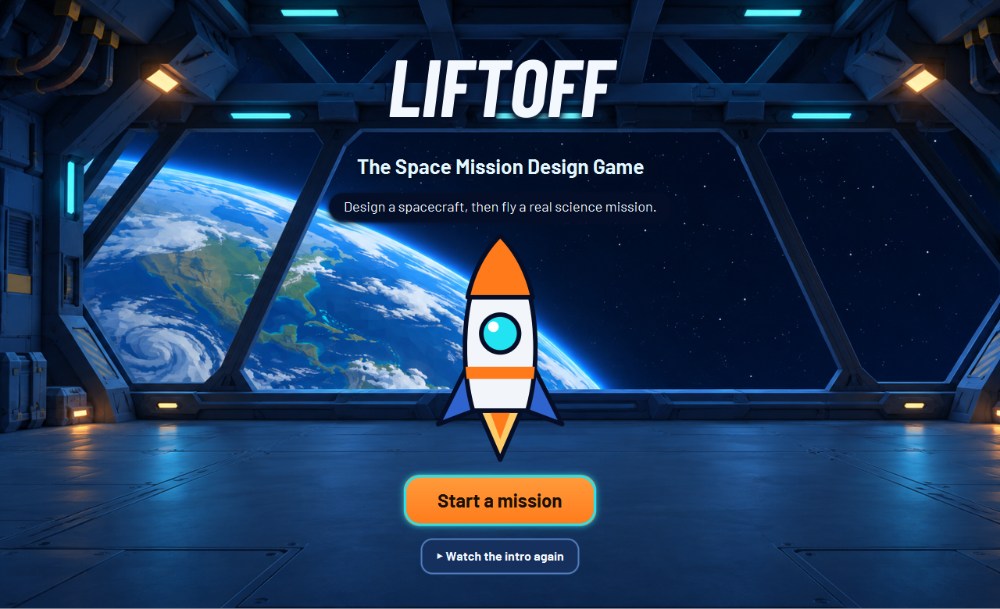
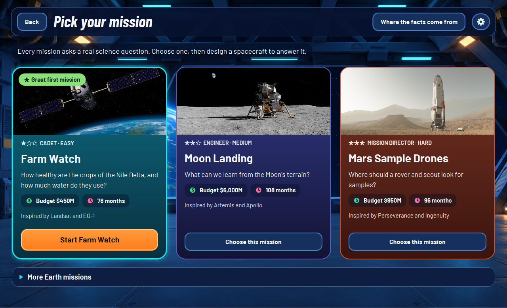
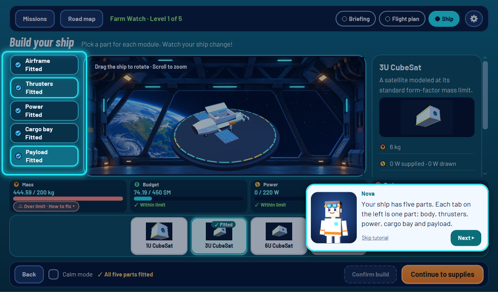
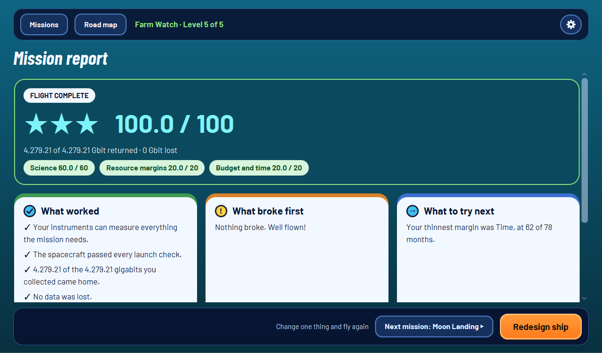

# LIFTOFF — The Space Mission Design Game

LIFTOFF is a space-science game for ages 7–13, created by team
404PlanetNotFound for NASA Space Apps Cairo 2026. Players plan missions, build
a spacecraft, fly the mission, and learn from a report explaining the outcome.

## Play on Windows

Download or clone this repository, then open `dist/LIFTOFF/` and run
`LIFTOFF.exe`. Keep the whole `LIFTOFF` folder together: the executable uses
the bundled Java runtime and game libraries in that folder, so a separate Java
installation is not needed. The app icon is the same rocket-and-hangar artwork
used by the game.

To rebuild the Windows app image from source on Windows, install a JDK 21+
and run:

```powershell
.\scripts\build-windows.ps1
```

The script writes the runnable app to `dist/LIFTOFF/`. To launch from source
instead:

```powershell
.\mvnw.cmd javafx:run
```

Run the test suite with:

```powershell
.\mvnw.cmd test
```

## The game

The player takes a mission from its briefing through planning, spacecraft
design, launch, flight, and a final report. The three missions progress from
Earth observation (Farm Watch), to a Moon landing, to Mars sample drones.
Players assemble a ship from modules and make trade-offs among mass, power,
budget, data, communications, time, and fuel. Mini-games and mission events
make the journey interactive; the report explains why a design worked or what
to change before trying again.

### Screenshots

These are captures of the running game:

| Title | Choose a mission |
|---|---|
|  |  |

| Build a spacecraft | Mission report |
|---|---|
|  |  |

## Project details

- **Purpose and impact:** make real mission-design trade-offs understandable
  through experimentation, not just reading about rockets and planets. The
  intended impact is to build curiosity about space science and systems
  thinking in young learners.
- **Benefits:** immediate feedback connects a design choice to several
  resources; players can safely test ideas, see why a mission failed, and
  redesign it. NASA-sourced catalog data and cited references ground the game
  in real missions.
- **Creative approach:** the player is an active mission designer, not a
  quiz-taker. Modular spacecraft construction, progressively harder
  destinations, interactive flight sequences, mini-games, and explanatory
  reports turn systems engineering into play.
- **Development tools:** Java 21, JavaFX 21 (FXML and CSS), Maven and its
  wrapper, Jackson for JSON catalogs, and JUnit 5. The game is a desktop app
  for Windows; its packaged app image includes a Java runtime.
- **Design considerations:** age-appropriate language, clear feedback,
  accessible contrast and controls, replayable failure, gradually increasing
  difficulty, and scientific accuracy. Published values are sourced; estimates
  and game rules are identified as such.
- **Team:** 404PlanetNotFound.

## Development and data

| Path | Contents |
|---|---|
| `docs/01-game-design.md` | Learning goals and original game design |
| `docs/05-missions-and-ship-builder.md` | Current mission and ship-builder direction |
| `docs/06-team-work-split.md` | Team work split |
| `docs/03-architecture.md` | Architecture and module boundaries |
| `docs/data-sources.md` | Sources and notes for catalog values |
| `src/main/java/com/liftoff/` | Game logic, session, UI, rendering, and audio |
| `src/main/resources/com/liftoff/catalog/` | Mission and spacecraft data |
| `docs/images/` | Screenshots captured from the game |

The model and simulation logic are kept separate from JavaFX. Mission and
spacecraft catalog data is stored as JSON and loaded with Jackson.
